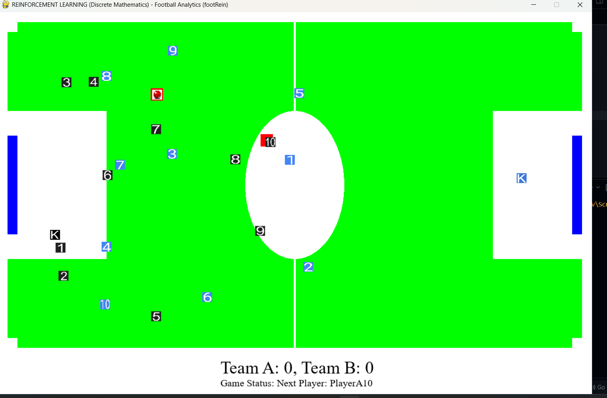
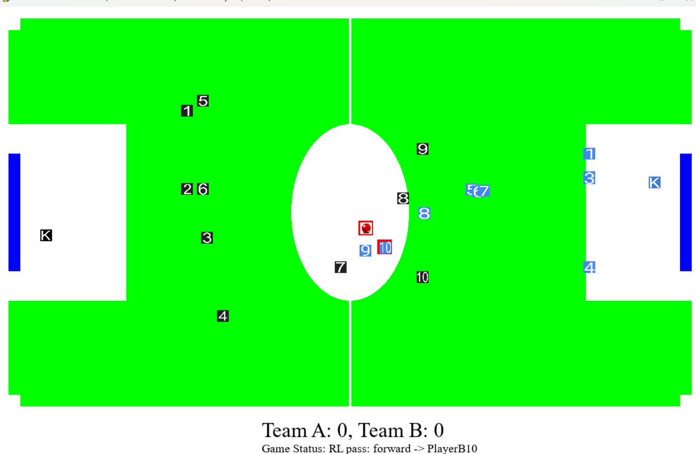
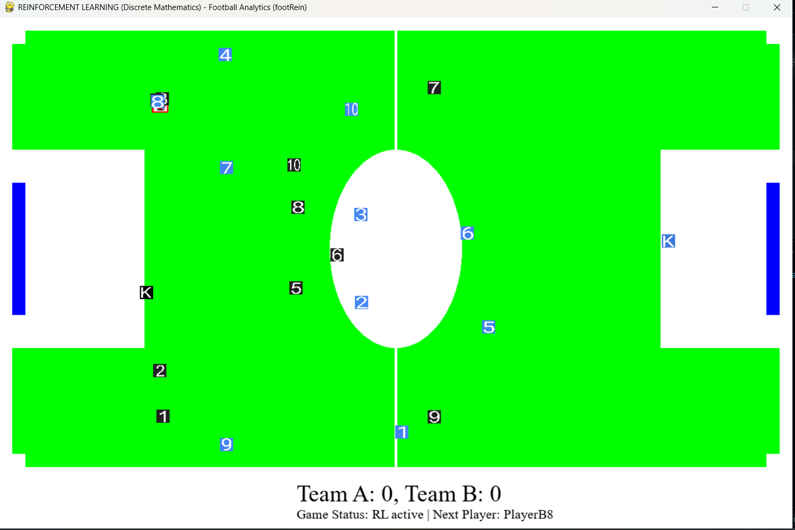
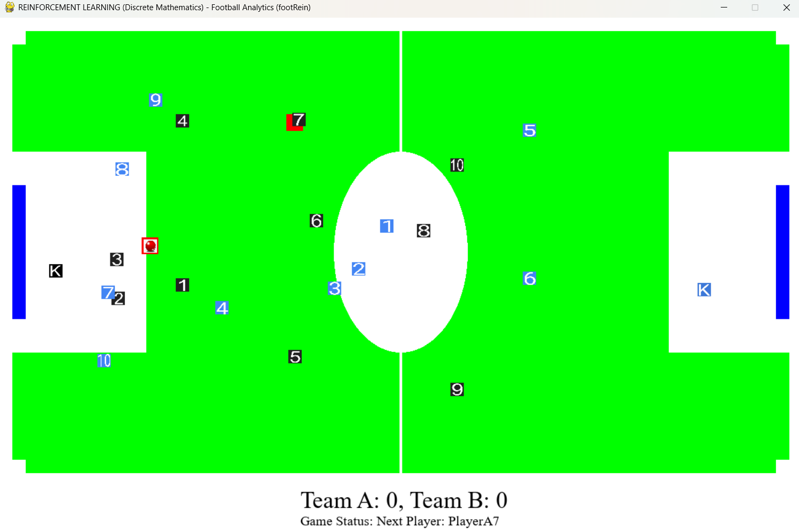
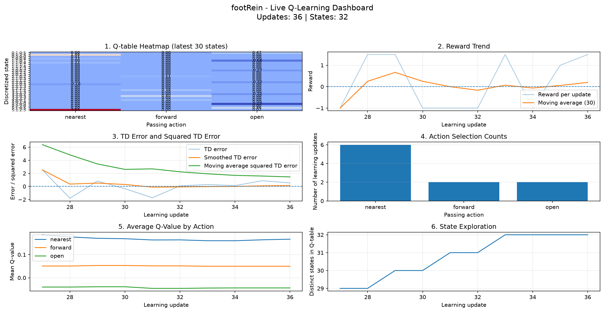

# ⚽ footRein — Reinforcement Learning-Based Football Simulation

**An interactive football simulation integrating Q-learning, reward-based decision-making, and live learning analytics.**

footRein is a reinforcement learning-based football simulation project that explores how an agent can learn passing decisions through interaction with a football environment. The system combines football gameplay, Q-table updates, reward feedback, and a live dashboard for monitoring the learning process.

The project visualizes key reinforcement learning metrics, including reward trends, temporal-difference (TD) errors, action-selection frequencies, average Q-values, and state exploration.

> **Project status:** Working prototype ready for initial technical review. Reward accounting, pass-completion tracking, and comparative performance evaluation are still being validated.

---

## 📸 Project Preview

<p align="center">
  
</p>

<p align="center">
  <em>Football simulation environment and project interface.</em>
</p>

### More Project Screenshots

<table>
  <tr>
    <td align="center">
      
      <br>
      <b>Simulation View 2</b>
    </td>
    <td align="center">
      
      <br>
      <b>Simulation View 3</b>
    </td>
  </tr>
  <tr>
    <td align="center" colspan="2">
      
      <br>
      <b>Simulation View 4</b>
    </td>
  </tr>
</table>

---

## 📊 Reinforcement Learning Dashboard

The live dashboard provides a visual overview of the agent's learning behavior and Q-learning metrics.

<p align="center">
  
</p>

### Dashboard Components

| Visualization | Description |
|---|---|
| Q-table Heatmap | Visualizes action-value estimates for discretized states. |
| Reward Trend | Displays recent rewards and their moving average. |
| TD Error | Tracks temporal-difference errors and squared TD errors. |
| Action Selection Counts | Shows how frequently each passing action is selected. |
| Average Q-value by Action | Compares average estimated values for available actions. |
| State Exploration | Tracks the number of distinct states visited during learning. |

These visualizations help inspect learning updates and identify potential issues in the reward and decision-making process. They do not, by themselves, establish that the agent performs better than a baseline strategy.

---

## 🎯 Project Objectives

- Integrate reinforcement learning into a football simulation environment.
- Explore passing decisions using Q-learning.
- Represent game situations using discretized states.
- Update action-value estimates using reward feedback.
- Monitor learning behavior through a live analytics dashboard.
- Record simulation results for further analysis.
- Establish a foundation for comparing learned behavior with a baseline strategy.

---

## 🧠 Reinforcement Learning Approach

### Q-Learning

Q-learning is a model-free, off-policy reinforcement learning algorithm that learns the expected long-term value of taking an action in a particular state.

The Q-value update is:

\[
Q(s,a) \leftarrow Q(s,a) + \alpha
\left[r + \gamma \max_{a'} Q(s',a') - Q(s,a)\right]
\]

Where:

- \(s\): Current state.
- \(a\): Selected action.
- \(r\): Reward received.
- \(s'\): Next state.
- \(\alpha\): Learning rate.
- \(\gamma\): Discount factor.
- \(Q(s,a)\): Estimated value of an action in a state.

The implementation maintains action-value estimates and updates them as learning transitions are processed.

### State Representation

The environment uses discretized state representations to group football situations into a finite set of states. The dashboard visualizes the distinct states visited during learning.

### Available Passing Actions

The current dashboard reports three action categories:

- **Nearest:** Select the nearest eligible teammate.
- **Forward:** Select a teammate associated with forward progression.
- **Open:** Select a teammate associated with the open-player option.

The exact selection logic depends on the implementation of the football environment and its player-selection rules.

### Reward Feedback

The learning process receives positive or negative reward values for transitions. These rewards are used to update Q-values.

The reward design and the mapping between actual football events and learning transitions are important areas of ongoing validation.

---

## 📈 Preliminary Results

During the recorded run on October 27, 2026, the system reported the following results:

| Metric | Recorded value |
|---|---:|
| Learning updates | 36 |
| Distinct states in dashboard | 32 |
| Pass attempts in episode log | 8 |
| Completed passes in episode log | 0 |
| Recorded interceptions | 6 |
| Goals scored by Team A | 0 |
| Goals scored by Team B | 1 |
| Episode reward sum | -6.0 |

### Action Selection Counts

| Action | Selections |
|---|---:|
| Nearest | 6 |
| Forward | 2 |
| Open | 2 |

The dashboard shows that Q-values are being updated, multiple states are being visited, and both positive and negative rewards are present.

**Important interpretation:** These are preliminary observations from a single recorded run, not evidence of a performance improvement. The zero completed-pass count indicates that pass-completion detection or reward integration needs further investigation.

A controlled comparison across multiple matches is required before drawing conclusions about the effectiveness of Q-learning.

---

## 🛠️ Technology Stack

- **Python** — Simulation and reinforcement learning logic.
- **Pygame** — Football simulation and graphical interface.
- **NumPy** — Numerical operations, where used by the implementation.
- **Matplotlib** — Learning analytics visualizations, where used by the dashboard.
- **Q-Learning** — State-action value learning.
- **CSV and JSON** — Storage of experiment results and Q-table data, where configured.

---

## 📂 Project Structure

```text
pyfootball-main/
│
├── pyfootball.py                  # Main simulation entry point
├── Scripts/
│   ├── net.py                     # Football environment and decision logic
│   ├── q_learning.py              # Q-learning implementation
│   ├── PlayersProperties.py       # Player properties
│   └── regression.py              # Supporting project logic
│
├── images/
│   └── others/                    # Project screenshots and assets
│       ├── 1.png
│       ├── 2.png
│       ├── 3.png
│       └── 4.png
│
└── rl_results/
    ├── episode_log.csv            # Recorded simulation results
    └── run_2026-10-27_13-39-24/
        └── all_plots.png           # Dashboard analytics
```

*The exact files and directory layout may vary depending on your local project version.*

---

## ⚙️ Installation and Setup

### 1. Clone the repository

```bash
git clone <YOUR_GITHUB_REPOSITORY_URL>
cd pyfootball-main
```

Replace the placeholder with your actual repository URL.

### 2. Create a virtual environment

```bash
python -m venv .venv
```

Activate it on Windows PowerShell:

```powershell
.\.venv\Scripts\Activate.ps1
```

If activation fails, verify that Python is installed and that the virtual environment was created successfully.

### 3. Install dependencies

Install the packages required by the project:

```bash
python -m pip install pygame numpy matplotlib
```

Additional dependencies may be needed depending on the existing project code. If a `requirements.txt` file is available, you can install the listed dependencies with:

```bash
python -m pip install -r requirements.txt
```

### 4. Run the simulation

Run the main Python file from the project root:

```bash
python pyfootball.py
```

---

## 🧪 Running the Available Modes

The updated implementation uses the `FOOTREIN_RL` environment variable to select the passing mode.

### Baseline mode

On Windows PowerShell:

```powershell
$env:FOOTREIN_RL = "0"
python pyfootball.py
```

### Q-learning mode

```powershell
$env:FOOTREIN_RL = "1"
$env:FOOTREIN_EPSILON = "0.15"
python pyfootball.py
```

### Greedy evaluation mode

```powershell
$env:FOOTREIN_RL = "1"
$env:FOOTREIN_EPSILON = "0"
python pyfootball.py
```

Greedy mode reduces or disables exploratory action selection when the implementation honors the configured epsilon value. Use it to inspect the current policy, not as proof that the policy is optimal.

---

## 💾 Experiment Logging

The project records learning and simulation information for later inspection.

Depending on the configured logging code, outputs may include:

- Episode timestamps and selected mode.
- Number of pass attempts and completed passes.
- Interception counts and goal counts.
- Episode reward totals.
- Q-table state-action values.
- Reward histories and TD-error histories.
- Action-selection counts and state-exploration metrics.
- Dashboard plots summarizing learning activity.

These outputs can be used to debug the learning pipeline and compare experiments.

---

## 🔬 Evaluation Plan

The next stage is to evaluate the learned policy against the baseline strategy.

A fair evaluation should use multiple matches under comparable conditions and report:

1. Pass-completion rate.
2. Interceptions per match.
3. Goals scored and conceded.
4. Win, draw, and loss rates.
5. Average cumulative reward.
6. Number of distinct states explored.
7. Variation in results across repeated runs.

Pass-completion and reward accounting should be verified before using these metrics to make performance claims.

---

## 🚧 Current Limitations

- The current results are preliminary and based on limited recorded data.
- Pass-completion tracking requires verification.
- Reward totals must be reconciled with the underlying learning transitions.
- Learning across separate program launches depends on whether the Q-table is explicitly saved and restored.
- A small number of updates cannot establish policy convergence.
- No controlled evidence currently demonstrates that the learned strategy outperforms the baseline.

---

## 🔮 Future Improvements

- Correctly integrate pass-completion and possession-change events with learning transitions.
- Validate that each selected action receives exactly one appropriate reward update.
- Add reliable Q-table persistence across sessions.
- Evaluate the policy across many complete matches.
- Add comparative performance charts for baseline versus Q-learning.
- Improve state representation with player positions, teammate availability, opponents, and field progression.
- Experiment with reward shaping and learning hyperparameters.
- Improve dashboard readability and episode-level reporting.

---

## 👨‍💻 Project Summary

footRein demonstrates the integration of a football simulation with tabular Q-learning and visual learning analytics. The current prototype provides a foundation for investigating reward-driven passing decisions and monitoring reinforcement learning behavior.


